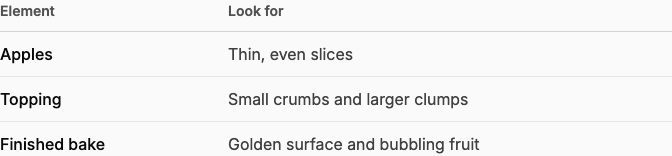
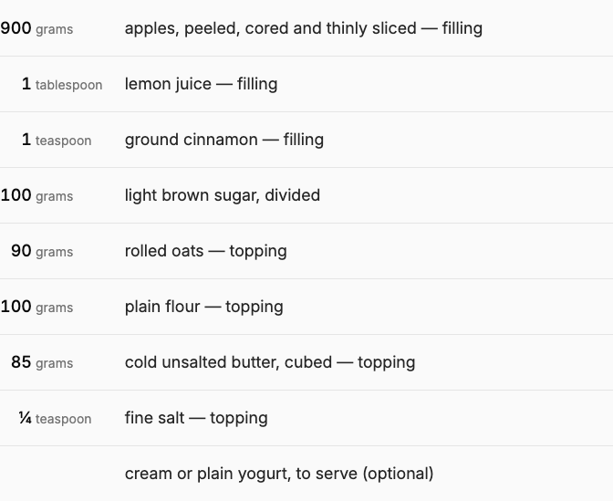
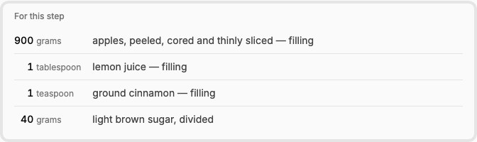
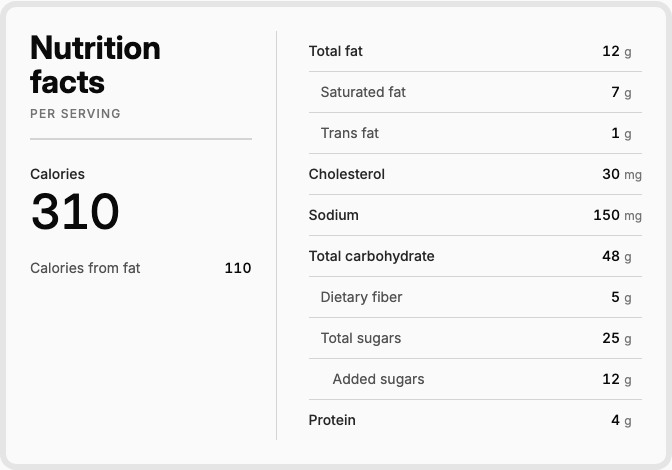

# Tables

Choose a table treatment by the reader's task. The current recipes establish three reusable roles—**Editorial**, **Measurement** and **Reference**—plus a specialized **Nutrition label**. Their different density, framing and hierarchy serve different purposes.

Approved by the site owner on 2026-10-21: Editorial, Measurement and Reference are the site's table styles; Nutrition remains a specialized label component. These definitions include the shared rules, style-specific defaults, content-owned structure and context-based selection below. The current recipe implementations supply the visual reference. Applying a style in an additional context remains a separate implementation task.

## Choose A Style

| Style | Use when the reader needs to… | Current example | Defining treatment |
| --- | --- | --- | --- |
| [Editorial](#editorial) | Compare descriptive information while reading | Overview's preparation and baking cues | Open edges, column headings, medium-weight row labels, moderate spacing |
| [Measurement](#measurement) | Read a complete list of amounts and named items | Main Ingredients | Open edges, larger reading type, aligned quantities and units |
| [Reference](#reference) | Consult a small supporting set while performing a task | Ingredients for one Step | Compact rows, short caption, rounded subtle frame |
| [Nutrition label](#nutrition-label) | Scan energy and a hierarchy of nutrients | Nutrition | A complete label composition with its own summary and table |

The introduction's icon-led recipe facts inset is a separate [metadata component](recipe-content.md#spacing-and-type). Its large numerals and grouped timing layout are not a table variant. Print is a separate action.

## Definition Boundaries

Use three levels of decisions when specifying or reusing these styles:

| Level | Defines | How to apply it |
| --- | --- | --- |
| Shared rules | Border palette, open-table ending, first-baseline alignment, aligned numeric figures, 4 px quantity/unit boundary where values and units are modeled separately, deliberate external spacing | Carry these principles across styles. |
| Style defaults | Type scale, row padding, frame thickness/radius, heading or caption hierarchy | Use the selected style's complete baseline. A compact Reference table keeps its denser spacing and frame; a primary Measurement list keeps its reading scale and open edges. |
| Content structure | Number and meaning of columns, authored widths, header relationships, units, caption wording, missing values | Follow the content model or authored table. Preserve native structure and meaningful relationships. |

Measurement and Reference share the recipe's quantity/unit/item arrangement, but have different roles in the page hierarchy. Their shared alignment is a reusable rule; their different density and framing remain part of their respective definitions. Editorial tables support authored column structures. Nutrition's energy summary and nutrient hierarchy stay owned by that specialized component.

### Selection By Context

Select a style through its content context. The approved context assignments are:

| Context | Selected treatment | Authoring responsibility |
| --- | --- | --- |
| Overview rich-text table | Editorial | Author columns, headings, content and any caption; the renderer supplies the approved visual treatment. |
| Recipe's master ingredient rows | Measurement | Author native quantities, units and names; the renderer supplies aligned tracks and reading density. |
| One Step's ingredient references | Reference | Select native ingredient references and step quantities; the renderer supplies the compact captioned frame. |
| Recipe nutrition fields | Nutrition label | Author available per-serving values; the component supplies labels, units and hierarchy. |

No new style picker is introduced by these definitions. A new content context should have an explicit style choice in its design specification. Extending Editorial to ordinary articles remains a separate decision; existing recipe context choices are the implemented reference.

## Shared Principles

### Edges And Rules

Open tables have rules between rows and no final closing rule. They have no outer frame or top rule; an editorial column-heading rule sits beneath the headings. Framed tables retain their enclosing border and avoid an extra closing bar within it.

Use the existing [border roles](../foundations/color.md#border-and-divider-rules): Neutral 300 for standard structure and Neutral 200 for deliberately quieter separation. The style summaries below identify where each belongs. Thickness, spacing and framing establish hierarchy within that palette.

### Alignment And Type

Align textual columns to the start and cells at their first text baseline. Keep numerical values aligned to a shared end boundary. Where values have units, use separate value/unit tracks with **4 px between the numeric end and unit start**. Units are smaller and quieter; a changing unit width must not move the numeric boundary.

Use tabular figures for aligned numeric values. Tabular figures and letter spacing are independent settings; preserve natural spacing rather than tightening quantities to make them fit. Ingredient expressions use the shared [quantity formatter](recipe-content.md#quantity-formatting), retaining authored fractions and decimals.

Editorial tables retain their authored columns and content-driven or authored widths. Measurement and Reference examples have quantity / unit / item tracks; Nutrition uses nutrient / value / unit tracks. Shared measurement alignment does not require the same column order.

### Surrounding Space

Cell padding controls spacing within the table. Heading-to-table separation belongs to the surrounding content layout: a 0 px top inset in the editorial heading cells does not itself supply that separation. Evaluate the table beneath an immediately preceding heading as well as after prose when applying the style.

Recipe Overview refinement, 2026-10-21, committed locally in runtime `5e0901f`: a heading immediately followed by an authored table figure has an explicit **20 px bottom gap** at every width. Other heading/content pairs retain their existing spacing. This restores contextual separation while keeping the approved 10 px body-cell padding and 0 px top padding inside the column headings.

### Content And Narrow Screens

Preserve captions, headings, authored emphasis and table structure. A visual row label does not by itself create semantic header markup; use appropriate native headers and scope when authoring or rendering header relationships.

Allow descriptive text to wrap. Keep numeric measures and their units readable. Wide authored tables use the existing contained horizontal scroller, keyboard focus and scroll hints; page-level overflow is not the intended fallback. See [Article Content](article-content.md) for the rich-text renderer and [Recipe Content](recipe-content.md) for recipe data and omission rules.

## Editorial

Use for comparisons or descriptive relationships within prose. The approved baseline is the **tighter Refined** treatment now applied to recipe Overview rich text.

| Element | Treatment |
| --- | --- |
| Body | 16 px / 24 px leading, normal weight 400, Neutral 700 at every width |
| First-column body labels | Weight 500, Neutral 950 |
| Column headings | 14 px / 20 px, weight 600, Neutral 600; 0 px top / 10 px bottom padding |
| Body cell padding | 10 px vertically; final body row has 0 px bottom padding |
| Column gutter | 24 px after each nonfinal column; 18 px through 480 px |
| Rules | 1 px Neutral 300 below column headings; 1 px Neutral 200 between body rows; no closing rule |
| Layout | Full available text-column width, native column sizing, first-baseline cell alignment |
| Immediately preceding heading | 20 px external gap in recipe Overview; owned by its content layout |

This treatment supplies a clear comparison without giving it the visual weight of another major recipe panel. Caption and surrounding prose/photo spacing remain owned by the content renderer. The approved implementation is scoped to Overview; ordinary article tables still retain their preceding prose styles.

## Measurement

Use for a primary list whose amounts need to be read alongside units and item names. The main Ingredients view is the current reference.

| Element | Current recipe baseline |
| --- | --- |
| Quantity and item type | 16 px / 28 px; 18 px / 32 px from `md` (768 px) |
| Quantities | Weight 500, tabular figures, Neutral 950; right-aligned |
| Item names | Normal weight 400, Neutral 800 |
| Units | Normal weight 400, Neutral 500; 12 px / 18 px, then 14 px / 20 px from `sm` (640 px) |
| Vertical cell padding | 12 px; 14 px from `md` |
| Column spacing | Quantity-to-unit 4 px; unit-to-name 16 px, then 24 px from `sm` |
| Rules | 1 px Neutral 200 between rows; no outer frame or closing rule |

The amount and unit columns size to their widest authored values, leaving the remaining width for names. Unitless and quantity-free rows retain the same name-column start. This is the spacious, primary-reading member of the family. Ingredient ordering, grammar and blank-value handling remain defined by [Ingredient Rows](recipe-content.md#ingredient-rows).

## Reference

Use for a small, contextual table subordinate to the task or passage around it. Step ingredients are the current reference: the method remains the dominant reading content.

| Element | Current recipe baseline |
| --- | --- |
| Body | 14 px / 24 px; normal-weight names in Neutral 700 |
| Quantities | Weight 500, tabular figures, Neutral 950 |
| Units | 12 px / 16 px, normal weight, Neutral 500 |
| Caption | 12 px / 16 px, weight 500, Neutral 500; 8 px below |
| Vertical cell padding | 6 px |
| Column spacing | Quantity-to-unit 4 px; unit-to-name 12 px, then 16 px from `sm` |
| Frame | 4 px Neutral 200; 12 px corners; no separate fill |
| Frame inset | 12 px horizontally, then 16 px from `sm`; 10 px vertically |
| Internal rules | 1 px Neutral 200 between rows; no extra first or final rule |

The frame identifies a contained reference, while smaller type and denser rows distinguish it from the full Measurement list. The caption states its local purpose, such as “For this step.” Native step references, divided quantities and placement relative to instructions remain defined by [Step Anatomy](recipe-content.md#step-anatomy-and-authoring).

## Nutrition Label

Nutrition is a specialized content component. Its heading, serving context, energy summary and nutrient table belong together.

| Element | Current recipe baseline |
| --- | --- |
| Frame | 6 px Neutral 200, 16 px corners, page background showing through |
| Frame inset | 20 px, then 24 px from `sm` |
| Nutrient rows | 14 px / 24 px; 8 px vertical cell padding |
| Main names and values | Weight 500; supporting names use 400 and a quieter color |
| Units | 12 px / 16 px, normal weight, Neutral 500; 4 px after values |
| Internal structure | Neutral 300 rules; supporting nutrient indentation follows authored parents |
| Final edge | No closing bar inside the frame |

The stronger internal rules preserve scan structure while the thick, softer outline recedes. At `sm`, summary and nutrient columns split; the first row on the right has no top rule. Narrow layouts stack the parts. The energy hierarchy, exact responsive composition, conditional nutrient indentation and authored-value rules remain defined by [Nutrition](recipe-content.md#nutrition).

Use this composition for nutritional information. Its hierarchy and emphasis depend on that content, so its frame alone does not define a general-purpose table style.

## Implementation And Review

The current styles use semantic tables and inline Tailwind utilities in `templates/_entry-content/recipe/page.twig`. The names on this page are design roles, not shipped CSS classes, CMS options or Twig component variants. Preserve native field handles and existing content ownership when reusing them; follow [Contributing](../contributing.md).

Source and rendered review, 2026-10-21: runtime `8d5eb6b`, frontend `2f80ae5`. Overview, Ingredients, Steps and Nutrition were inspected on local dev at 390/1440 px. Screenshots above show sample data. The [retained style inventory](../assets/reports/table-styles-2026-10-21.json) records computed styles and page fit. The editorial implementation also passed checks at 320/390/640/768/1440 px, contained keyboard horizontal scrolling, and required local release QA before commit.

The owner approved the definitions and context-selection rules on 2026-10-21. Approval establishes the design standard; no additional website restyling accompanies this finalization. The local implementation evidence above does not establish a production release, broader content migration, or a completed screen-reader/cross-browser audit.
