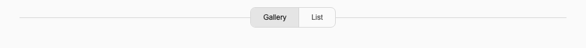
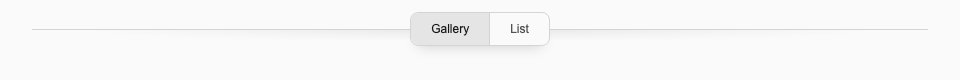

# Scroll Separation

Use this treatment to distinguish sticky segmented navigation from content scrolling beneath it. It combines a fine horizontal divider, an opaque page-matching cover and a subtle shadow following the divider and the control's rounded lower edge.

Approved for reuse locally on 2026-10-21, after refinement in [Recipes](../components/recipe-content.md). The shared implementation is committed locally at runtime `b073772` and frontend `2f80ae5`; it has not been deployed to production. Opt in through the shared wrapper. The ordinary [segmented control](../components/navigation.md#reusable-segmented-control) retains its existing appearance.

## Appearance And States

Before content reaches the divider, the control and rule remain flat:



When content passes beneath the divider, a shallow shadow separates the layers:



The shadow should register as depth, with little visual weight. Keep its depth shallower beside the control, preserve the horizontal fade and let the deeper part follow the control itself. The earlier single oval is historical and should not be reused.

| State | Treatment |
| --- | --- |
| Normal flow, or sticky before content reaches the rule | No shadow. |
| Content passes beneath the rule | Both shadow layers fade in together over 150 ms. |
| Scroll back above that boundary | Both layers fade out. |
| Reduced motion | State changes without a transition. |
| Print | Navigation, cover and shadow are hidden. |
| JavaScript unavailable | Shadow stays hidden; the CSS cover and native links remain usable. |

## Anatomy And Standard Values

These values have one implementation source in `_components/scroll-separation.twig`; reuse that component rather than copying the utilities into callers.

| Part | Standard |
| --- | --- |
| Divider | 1 px Neutral 300, meeting the control at its midpoint. |
| Cover | Upper half of the navigation row, matching the opaque page canvas; Neutral 50 by default. |
| Divider shadow | 24 px-high radial gradient centered on the rule, with 12 px below it. Black fades from 7.5% through 2.5% to transparent. |
| Horizontal fade | Maximum 48 rem wide; article container plus 32 px on narrow screens, with adequate page gutters. |
| Control shadow | Matches the actual control shell: 38 px high on phones, full shell height from `md`, same width and 8 px corners. |
| Control shadow values | 8 px downward offset, 14 px blur, −8 px spread, 18% black. |
| Upper clipping | Static clip at the control midpoint, with space for the lower and side blur. |
| Motion | 150 ms opacity transition; none with reduced motion. |

The shadow layers are decorative and ignore pointer input. The cover blocks interaction with content it hides, while links and content below the rule retain their pointer targets. Keep content in a lower stacking context. Maintain the control's existing link semantics, focus outlines and touch targets.

## Reuse In Templates

The shared wrapper includes the existing segmented control. It accepts its `label`, `options`, `currentValue`, `compact` and `controlClass` settings, plus:

| Input | Responsibility |
| --- | --- |
| `shadowVisible` | Trusted Alpine boolean expression; defaults to `false`. Both layers use this state. |
| `attributes` | Caller hooks, such as `x-ref="navigation"`. |
| `placementClass` | Sticky offsets, stacking and outer spacing. Default is `sticky top-20 z-20 md:top-24`, beneath the site's normal header. |
| `surfaceClass` | Opaque canvas utility matching the surrounding page; defaults to `bg-neutral-50`. |

Use template-authored Alpine expressions and attributes, following the same trusted-template boundary as the segmented control.

```twig
<div x-data="collectionBrowser()" class="bg-neutral-50">
    
    <div class="relative z-0">
        <span x-ref="contentStart" aria-hidden="true"
              class="pointer-events-none absolute left-0 top-0 h-px w-px print:hidden"></span>
        {# Content belonging to this navigation. #}
    </div>
</div>
```

The caller keeps its native destinations, view state and content layout. Register its Alpine provider through the site's normal setup. In that provider, connect the shared observer after refs exist and dispose of it on destruction:

```js
import observeScrollSeparation from "./scroll-separation.js";

export default function collectionBrowser() {
  let stop = null;
  return {
    contentVisible: false,
    init() {
      this.$nextTick(() => {
        stop = observeScrollSeparation({
          navigation: this.$refs.navigation,
          contentStart: this.$refs.contentStart,
          layout: this.$el,
          onChange: visible => { this.contentVisible = visible; },
        });
      });
    },
    destroy() { stop?.(); },
  };
}
```

The observer detects content crossing the navigation midpoint. Its lower boundary includes the document, so fast scroll jumps still register. Layout observation refreshes it when dimensions change. It updates only a visibility boolean; the stationary CSS cover handles content cutoff without scroll listeners or per-frame measurements.

## Usage Rules

- Use for a sticky control with associated content moving beneath it. An ordinary in-flow control does not need elevation.
- Match the cover to a uniform surrounding canvas. A gradient or mismatched fill can reveal a band.
- Leave enough horizontal gutter for the fade and enough vertical clearance for focus outlines. Keep the full control visible below the site header.
- Preserve these values for this treatment. A new context that needs materially different geometry should be reviewed as a variant.
- Keep full-screen viewers outside the covered content layers.

## Verification

Local source and Chromium review, 2026-10-21, above runtime `f47d90c` and frontend `de9e961` with uncommitted shared-component/helper changes: extraction preserves recipe navigation/control/content geometry at 320/375/390/640/768/1440 px. Phone and desktop screenshots are byte-identical to the preceding approved contour treatment. Recipe navigation, history, keyboard, native fallback, print and image viewing checks pass. A separate unsaved Collection views example uses different labels and a different Alpine state expression, checks both states on phone/desktop, and verifies observer cleanup. The previews above come from that neutral example. Cross-browser and screen-reader review remain outstanding; no production deployment is claimed.
